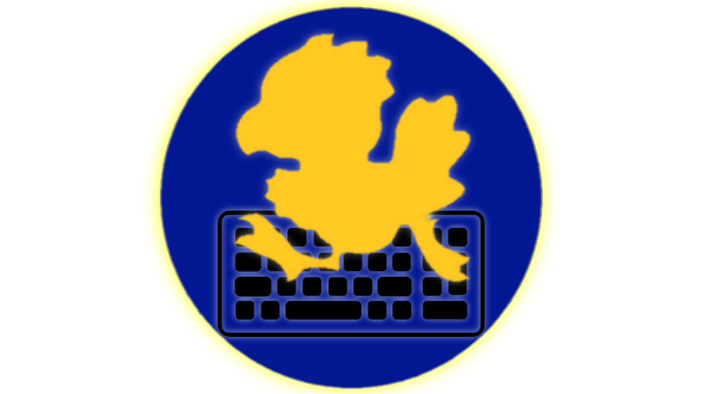
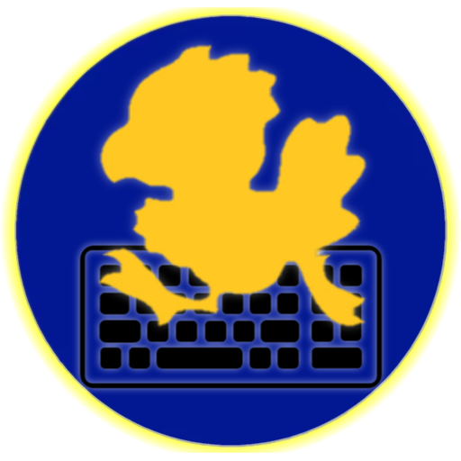
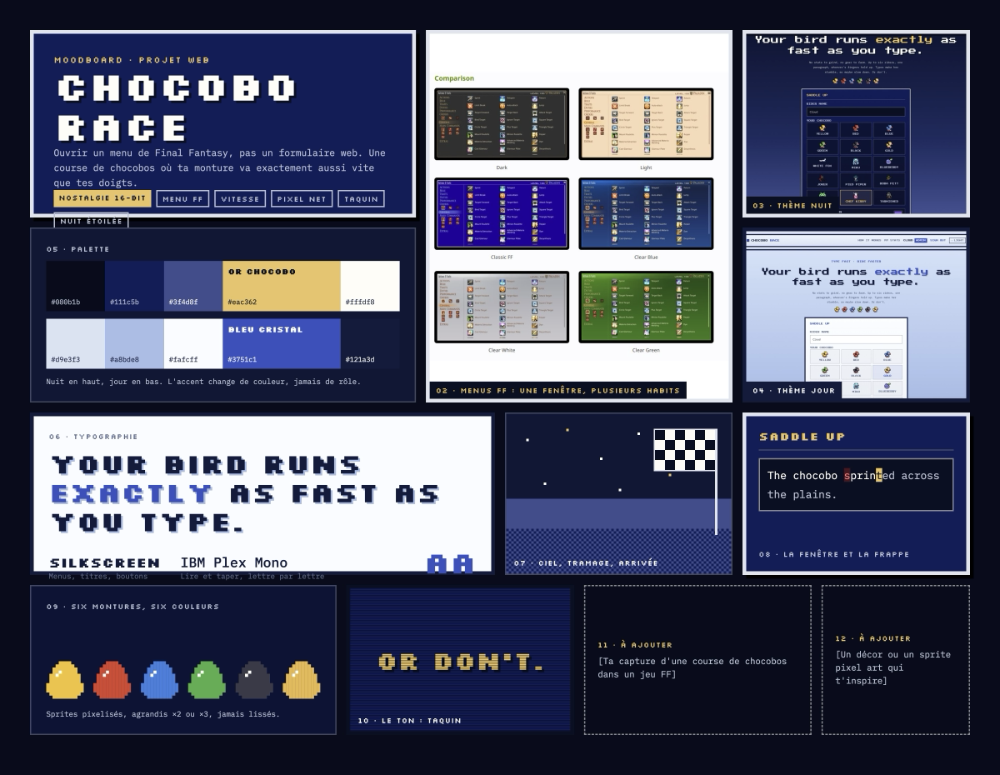
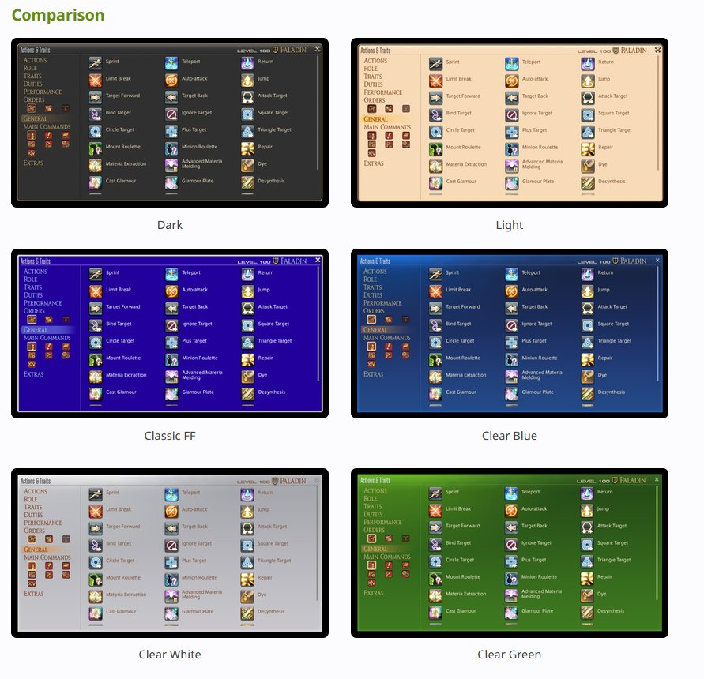
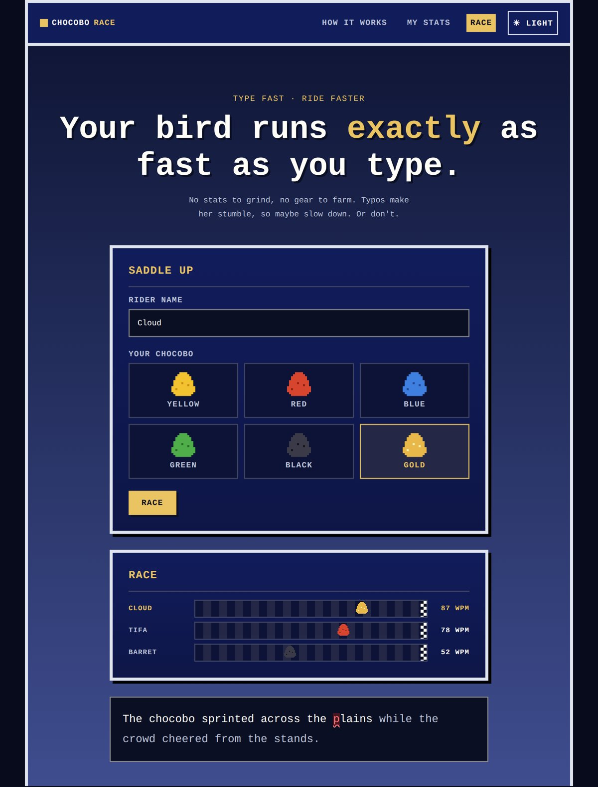
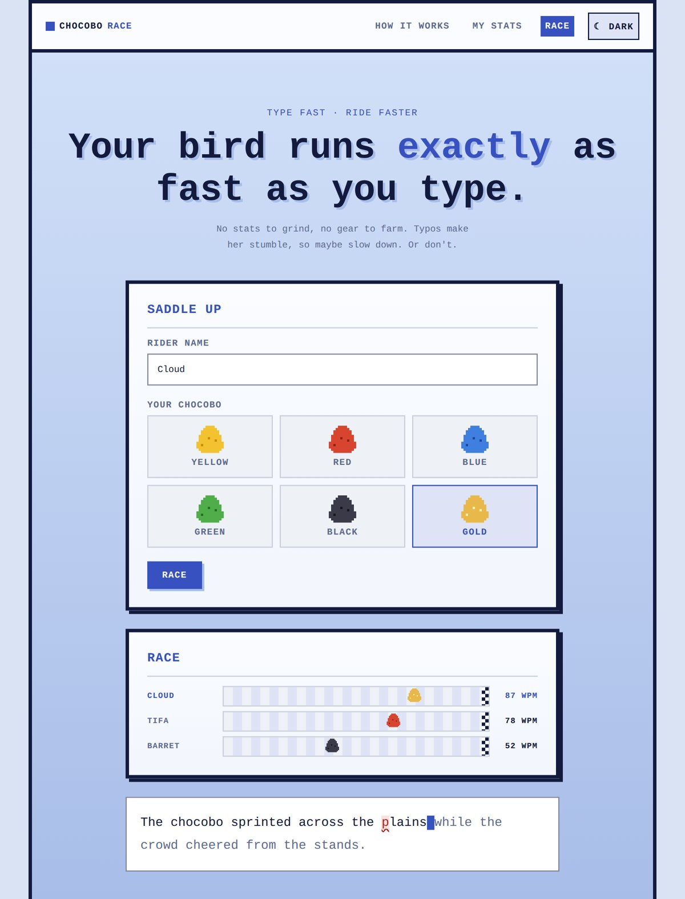
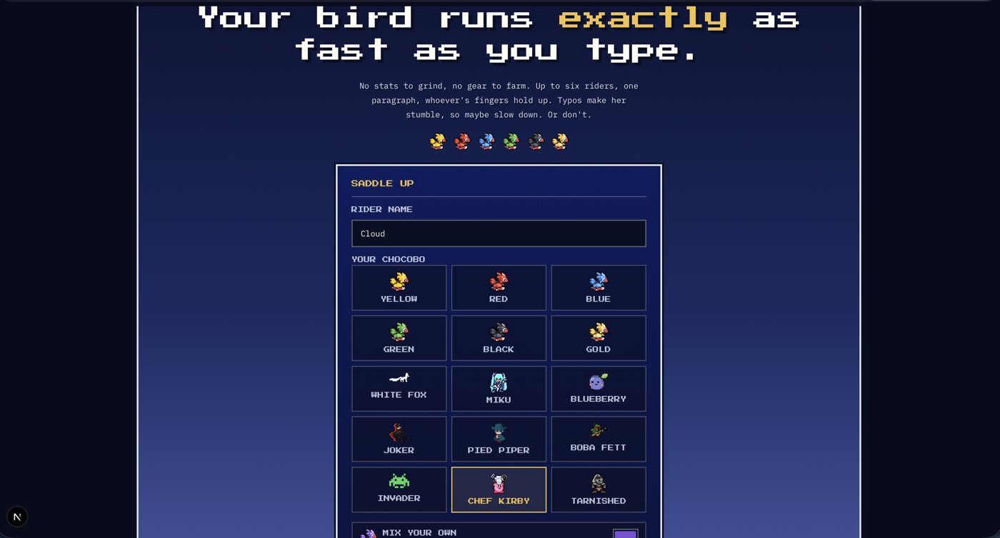

# Démarche créative

Nom, logo et direction artistique de Chocobo Race (DES-01 à DES-03). Le nom
et le logo viennent de moi, sans IA. La direction artistique a été fixée
avant le développement, dans une charte de design et un moodboard; la
dernière section dit ce qui a changé une fois le site construit.

**Principe directeur : le site doit donner l'impression d'ouvrir un menu de
jeu, pas un formulaire web.**

## 1. Nom (DES-01)

**Un seul nom a été envisagé : Chocobo Race.** Il est venu avec l'idée du
jeu elle-même, une course de chocobos où la monture avance au rythme de la
frappe, et il n'a jamais changé depuis.

**Vérification d'originalité.** Aucun produit connu ne s'appelle exactement
« Chocobo Race ». Deux noms proches existent et sont assumés comme la
référence du thème : *Chocobo Racing* (jeu de course de Square, 1999, sur
PlayStation) et les courses de chocobos du Gold Saucer de *Final Fantasy
VII*. Le mot « chocobo » vient de l'univers Final Fantasy (Square Enix); le
site est un projet scolaire non commercial qui lui rend hommage. Le nom a
été remis au checkpoint 1, où il est devenu définitif.

## 2. Logo (DES-02)

Le logo est dessiné à la main : un chocobo en silhouette qui court sur un
clavier, dans un cercle bleu nuit au halo doré. Il réunit les deux idées du
jeu, la course de montures et la frappe au clavier, avec les deux couleurs
de la direction artistique (le bleu des fenêtres de menu, l'or du chocobo).

| Dessin original | Version détourée (dans le site) |
| --- | --- |
|  |  |

- `design/logo-original.png` : le dessin tel quel, jamais retouché.
- `public/logo.png` : le même dessin détouré sur fond transparent (halo
  gardé). Il est affiché dans l'en-tête de chaque page (`Wordmark`) et sur
  l'accueil.
- `app/icon.png` et `app/apple-icon.png` : l'icône d'onglet (favicon) et
  d'écran d'accueil, tirées du même dessin.

Le logo a été fait **en une seule itération** : il n'y a pas eu de croquis
préalables ni de versions successives. `design/logo-original.png` est ce
dessin, tel qu'il a été fait; c'est lui qui tient lieu de croquis (DES-02).
La seule retouche est le détourage pour le site.

## 3. Direction artistique (DES-03)

### Concept

Chocobo Race est une course de dactylographie : chaque cavalier tape le même
paragraphe, et sa monture court exactement aussi vite que ses doigts.
L'interface emprunte à deux univers :

- les **fenêtres de menu des Final Fantasy** : cadre épais, fond bleu nuit,
  texte blanc et or;
- l'**esthétique pixel des jeux 8 et 16 bits** : polices bitmap, sprites,
  ombres dures, aucun coin arrondi.

### Moodboard

Les références retenues :

1. **Les menus Final Fantasy et leurs thèmes de couleur** (Dark, Light,
   Classic FF, Clear Blue…) : une même fenêtre déclinée en plusieurs
   habillages. On en tire l'idée d'un thème Nuit (proche de Classic FF et
   Dark) et d'un thème Jour (proche de Clear Blue et Light).
2. **Les courses de chocobos** : la course comme boucle de jeu, et les
   montures colorées (jaune, rouge, bleu, vert, noir, or) comme identité du
   joueur.
3. **Le pixel art rétro** : sprites agrandis ×2 ou ×3 sans lissage
   (`image-rendering: pixelated`), ciel étoilé, tramage, drapeau d'arrivée à
   damier.
4. **Le ton taquin** : phrases courtes qui parlent au joueur (« Typos make
   her stumble, so maybe slow down. Or don't. »).

*Référence : déclinaisons de couleur des fenêtres de menu de Final Fantasy
(captures d'interface de Square Enix, utilisées comme inspiration).*

### Palette de couleurs

Deux thèmes, mêmes rôles : seule la valeur d'une couleur change, jamais son
rôle. L'accent est l'**or chocobo** la nuit et le **bleu cristal** le jour.

| Rôle | Nuit | Jour |
| --- | --- | --- |
| Fond de page | `#080b1b` | `#d9e3f3` |
| Fenêtre | `#111c5b` | `#fafcff` |
| Bas de la scène | `#3f4d8f` | `#a8bde8` |
| Texte principal | `#fffdf8` | `#121a3d` |
| Texte secondaire | `#bbc2d8` | `#5e6a90` |
| **Accent** | **`#eac362` (or chocobo)** | **`#3751c1` (bleu cristal)** |
| Erreur de frappe | `#ff7a7a` | `#b3261e` |
| Succès | `#8ee29a` | `#1e6b34` |

Règles :

- un seul accent par zone (dans le grand titre, un seul mot : « exactly »);
- le rouge et le vert sont réservés à la frappe et aux résultats, ils ne
  décorent rien;
- une tuile sélectionnée se reconnaît par trois signaux (fond, bordure,
  libellé), jamais par la couleur seule;
- contraste du texte d'au moins 4,5:1 dans les deux thèmes.

### Typographies

Deux familles, deux rôles, jamais inversés :

| Police | Rôle |
| --- | --- |
| Police pixel (Google Fonts) | Tout ce qui est « menu » : titres, libellés, boutons, navigation, chiffres. En capitales, sauf le grand titre. |
| **IBM Plex Mono** (Google Fonts) | Tout ce qui se lit ou se tape. La chasse fixe aligne le curseur de frappe sur une grille de lettres. |

### Formes, mouvement et ton

- Tout est multiple de 4 px, comme une grille de pixels. Pas de coins
  arrondis, pas de flou; bordures pleines, ombres décalées sans flou.
- Animations en paliers (`steps()`), pas en courbes douces; le curseur
  clignote. Avec `prefers-reduced-motion`, le curseur ne clignote plus.
- Ton complice et un peu taquin, vocabulaire de cavalier (*Saddle up*,
  *rider*, *mount*, *finish line*), pas d'émojis.

### Maquettes

| Thème Nuit | Thème Jour |
| --- | --- |
|  |  |

## 4. Deux thèmes (DES-05)

La direction artistique est pensée pour deux thèmes dès le départ (Nuit et
Jour, comme les habillages des menus FF). Au premier chargement, le thème
suit la préférence du système (`prefers-color-scheme`); le bouton ☀ / ☾ de
l'en-tête le change, et un script lancé avant le premier affichage applique
le choix gardé, donc sans flash du mauvais thème.

## 5. De la charte au site

Une fois le site construit, quelques choix ont bougé par rapport à la
charte :

- **Police pixel** : la charte prévoyait Silkscreen; le site utilise
  **Press Start 2P** (`app/layout.tsx`), une autre police pixel de Google
  Fonts, dans le même rôle. IBM Plex Mono est restée pour le texte.
- **Couleurs** : mêmes rôles, valeurs ajustées dans `app/globals.css`, par
  exemple l'or chocobo `#f2c14e` (nuit) et le bleu cristal `#2f52c8` (jour).
  Les couleurs des graphiques de résultats ont été ajoutées et validées
  pour chaque thème.
- **Montures** : en plus des six chocobos de couleur, des montures à
  débloquer et une couleur personnalisée.
- **Capacité** : la charte parlait de six cavaliers; le travail de session
  demande jusqu'à 30 participants (SALLE-05), donc la piste passe en barres
  compactes au-delà de 10 participants.

*Une première version du site en thème Nuit, avec la grille des montures.*
